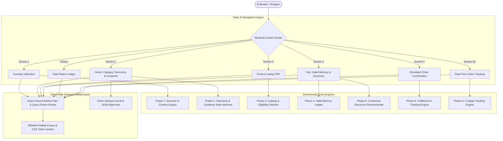
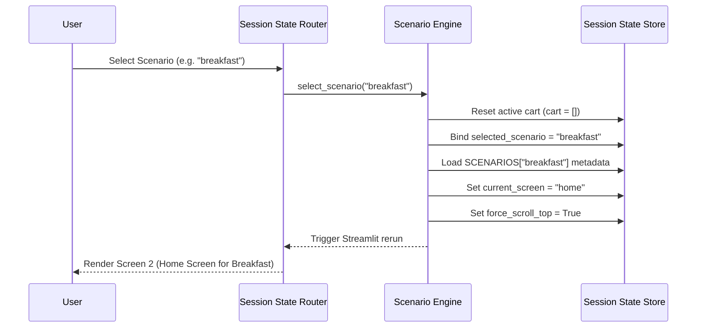
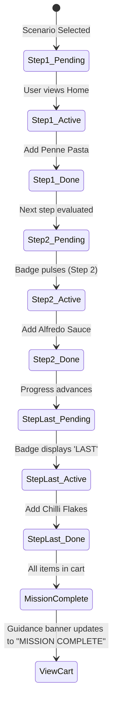
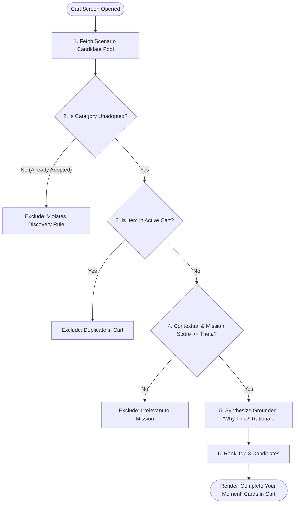
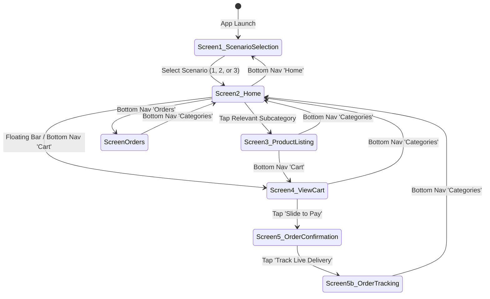

# BlinkitSense — End-to-End System Architecture Specification

## 1. Executive Architecture Overview & System Topology

BlinkitSense is an AI-powered contextual product discovery concept built on top of quick-commerce shopping dynamics. The system demonstrates how a habitual customer, constrained by fixed grocery routines, can be gently guided toward exploring and adopting products from previously untried categories during their regular shopping missions—without friction, aggressive ads, or irrelevant recommendations.

### 1.1 Core Architectural Principles
1. **Zero External API Dependency**: The entire recommendation, classification, habit memory, and catalog engine executes deterministically using local in-memory datasets and algorithms without external AI service latency or failure points.
2. **Strict Scenario Session Isolation**: Each scenario represents an independent shopping occasion with its own cart, browsing state, and contextual mission, while maintaining a single shared immutable historical orders ledger.
3. **Habit Memory Immutability**: Historical order records are strictly read-only. Cart additions, scenario switches, and simulated checkouts never silently rewrite historical data.
4. **Explainable, Fact-Grounded Recommendations**: Every suggested discovery product must include a concise, verifiable *"Why this?"* rationale derived exclusively from configured persona signals, weather, mission context, and unadopted category status.
5. **Mobile-First High-Fidelity UI**: Styled with custom CSS mimicking the Blinkit mobile app (iOS 390×844 frame, status bar, dynamic search header, squircle category grids, floating cart bar, and 4-tab bottom navigation).



---

## 2. Phase 1: Persona, Mission Context & Session Isolation Engine

### 2.1 Persona Specifications
- **Name**: Rohan Mehta (29, Product Manager, Bengaluru, living alone).
- **Tenure & Habit**: 2 years on Blinkit, 4–6 orders/month, average order value ₹600–₹800.
- **Behavioral Preferences**: Prefers products under ₹500, ratings $\ge 4.0$ stars, high review volume, value-oriented brands. Open to trying new categories only when functional benefit is evident.

### 2.2 Scenario Occasion Vectors
The engine injects time, day, weather, and occasion constraints into the shopping session:

| Attribute | Scenario 1: Cooking at Home | Scenario 2: Quick Breakfast | Scenario 3: First-Time Period Care |
| :--- | :--- | :--- | :--- |
| **Occasion ID** | `cooking` | `breakfast` | `period_care` |
| **Context Label** | `SATURDAY · 7:05 PM` | `MONDAY · 8:15 AM` | `WEDNESDAY · 8:20 PM` |
| **Weather & Icon**| `🌧️ Bengaluru · Heavy rain` | `☀️ Bengaluru · Hot and sunny` | `🌙 Bengaluru · Warm evening` |
| **Mission Objective**| Prepare dinner at home | Quick low-effort breakfast before 9:30 AM meeting | Essential period-care products in a discreet journey |
| **Authoritative Mission Products** | Penne Pasta, Alfredo Sauce, Mushrooms, Cheese, Chilli Flakes | Bananas, Greek Yogurt, Granola, Orange Juice | Nua Sanitary Napkins, Dark Chocolate, Ice Cream Tub |

### 2.3 Session State Isolation Architecture
When a scenario is selected via `select_scenario(scenario_id)`:
1. `st.session_state.cart = []`: Active cart is purged.
2. `st.session_state.selected_scenario = scenario_id`: Scenario ID is anchored.
3. `st.session_state.scenario_data = SCENARIOS[scenario_id]`: Contextual vector is loaded.
4. `st.session_state.active_subcat` and `selected_subcat` reset to the first guided subcategory.
5. `st.session_state.current_screen = "home"`: Direct routing to the scenario's home screen.
6. `st.session_state.current_order`: Pre-existing simulated order snapshots are preserved without mutation or mixing.



---

## 3. Phase 2: Taxonomy Engine & Dynamic Guidance State Machine

### 3.1 Taxonomy Structure
The product catalog adheres to a strict 4-category taxonomy with 32 structured subcategories:
1. **Grocery & Kitchen** (8 subcategories): *Vegetables & Fruits, Atta, Rice & Dal, Oil, Ghee & Masala, Dairy, Bread & Eggs, Bakery & Biscuits, Dry Fruits & Cereals, Chicken, Meat & Fish, Kitchenware & Appliances.*
2. **Snacks & Drinks** (8 subcategories): *Chips & Namkeen, Sweets & Chocolates, Drinks & Juices, Tea, Coffee & Milk Drinks, Instant Food, Sauces & Spreads, Paan Corner, Ice Creams & More.*
3. **Beauty & Personal Care** (8 subcategories): *Bath & Body, Hair, Skin & Face, Beauty & Cosmetics, Feminine Hygiene, Baby Care, Health & Pharma, Sexual Wellness.*
4. **Household Essentials** (8 subcategories): *Home & Lifestyle, Cleaners & Repellents, Electronics, Stationery & Games, Stores, E-Cards.*

### 3.2 Dynamic Mission Guidance & Step-Numbering Algorithm
In `app.py`, `get_scenario_guidance(scenario_id, cart)` calculates mission progress deterministically:

1. **Guided List Resolution**:
   - `cooking`: `["Instant Food", "Sauces & Spreads", "Vegetables & Fruits", "Dairy, Bread & Eggs", "Oil, Ghee & Masala"]` (5 steps)
   - `breakfast`: `["Vegetables & Fruits", "Dairy, Bread & Eggs", "Instant Food", "Drinks & Juices"]` (4 steps)
   - `period_care`: `["Feminine Hygiene", "Sweets & Chocolates", "Ice Creams & More"]` (3 steps)

2. **Step-Wise Ordinal Badge Assignment**:
   Each guided subcategory is tagged with an ordinal badge on its top-left squircle:
   $$\text{Badge}(s) = \begin{cases} 
   \text{"✓"} & \text{if product from } s \text{ is in cart} \\
   \text{"LAST"} & \text{if } \text{index}(s) = \text{len}(\text{guided}) - 1 \\
   \text{str}(\text{index}(s) + 1) & \text{otherwise}
   \end{cases}$$

3. **Dynamic Visual Feedback Hierarchy**:
   - **Scenario-Relevant Category Headers**: Styled with `.category-title-highlighted` yellow background band and `⚡ N relevant` pill.
   - **Relevant Subcategories**: Styled with `.subcat-tile-label-highlighted` and a small yellow guidance dot.
   - **Next Action Cue**: The first unfulfilled subcategory receives `.subcat-card-next-action` with an animated pulsing badge (`.subcat-step-badge-next`).
   - **Completed Step**: Turns into green checkmark (`.subcat-done-check`).
   - **Irrelevant Categories/Subcategories**: Visible but rendered unhighlighted and disabled (`.subcat-card-disabled`) with `pointer-events: none`.



### 3.3 Scenario 3 Viewport Auto-Alignment Engine
When Scenario 3 (*First-Time Period Care*) is loaded, the user must immediately see the relevant subcategories in *Beauty & Personal Care* (*Feminine Hygiene*) and *Snacks & Drinks* (*Sweets & Chocolates*, *Ice Creams & More*) without manual scrolling:
- An invisible DOM marker `#scenario3-scroll-anchor` is rendered inside *Beauty & Personal Care*.
- `reset_screen_scroll("scenario_3_home")` fires `requestAnimationFrame` multi-retry JavaScript:
  $$\text{TargetScrollTop} = \text{Anchor}.\text{offsetTop} - \text{Container}.\text{clientHeight} + 220 \approx 500\text{px}$$
- The phone container (`.block-container`) smoothly positions *Beauty & Personal Care* anchored at the bottom edge, revealing both relevant categories simultaneously.

---

## 4. Phase 3: Authoritative Product Catalog & Eligibility Pipeline

### 4.1 Product Schema (`catalogue.py`)
All items belong to the authoritative `PRODUCT_CATALOGUE` list with stable identifiers:

```python
{
    "id": str,                  # e.g., "p_pasta"
    "name": str,                # e.g., "Penne Pasta"
    "category": str,            # Top-level taxonomy category
    "subcategory": str,         # Canonical subcategory
    "price": int,               # Positive integer in INR
    "weight": str,              # e.g., "500g"
    "scenarios": List[str],     # Permitted scenario IDs ["cooking", "breakfast"]
    "icon": str,                # Illustrative emoji / vector symbol
    "is_highlighted": bool,     # Highlighting flag for scenario products
    "group": str,               # Taxonomy sub-cluster (e.g., "Grains & Pasta")
    "rating": float,            # 4.3 - 4.8
    "reviews_count": int,       # Configured social proof count
    "badges": List[str],        # e.g., ["Bestseller", "⚡ 10 mins"]
}
```

### 4.2 5-Tier PDP Eligibility Validation (`get_valid_products`)
When a user opens a subcategory on Screen 3, products pass through five strict validation filters:

$$\text{ValidProducts} = \{ p \in \text{PRODUCT\_CATALOGUE} \mid \text{Passes}(p) \}$$

1. **Scenario Membership**: $p.\text{scenarios} \ni \text{active\_scenario}$
2. **Category-Subcategory Conformance**: $p.\text{subcategory} = \text{selected\_subcat}$
3. **Non-Discovery Filter**: $p.\text{group} \neq \text{"Discovery"}$ (BlinkitSense discoveries appear only in Cart)
4. **Data Integrity Gate**: $p.\text{id} \neq \emptyset \land p.\text{name} \neq \emptyset \land p.\text{price} > 0 \land p.\text{weight} \neq \emptyset$
5. **Deterministic Product Ordering**:
   $$\text{SortKey}(p) = \begin{cases} 
   0 & \text{if } p.\text{id} \in \text{SCENARIO\_SELECTED\_PRODUCTS}[\text{scenario}] \\ 
   1 & \text{otherwise} 
   \end{cases}$$
   The scenario's target product (e.g., Penne Pasta) is guaranteed to appear **first**, styled with an emerald green border and yellow dot indicator, while catalogue filler items follow beneath.

---

## 5. Phase 4: Habit Memory & Historical Ledger Intelligence

### 5.1 Historical Orders Dataset (Weeks 1–8)
The habit memory dataset reflects Rohan's habitual quick-commerce history over 8 weeks:

| Week | Order ID | Order Total | Line Items Breakdown | Adopted Subcategories Added |
| :---: | :---: | :---: | :--- | :--- |
| **W1** | `ORD_001` | ₹612 | Milk (60), Eggs (85), Bread (45), Bananas (38), Pasta (145), Pasta Sauce (149), Chips (45), Coke (45) | Dairy, Bread & Eggs; Veg & Fruits; Instant Food; Sauces & Spreads; Chips & Namkeen; Drinks & Juices |
| **W2** | `ORD_002` | ₹487 | Milk (60), Eggs (85), Bread (45), Chicken (150), Onions (35), Tomatoes (32), Coffee (40), Biscuits (40) | Chicken, Meat & Fish; Tea, Coffee & Milk Drinks; Bakery & Biscuits |
| **W3** | `ORD_003` | ₹731 | Milk (60), Eggs (85), Veg (80), Pasta (145), Sauce (75), Cheese (110), Chilli Flakes (45), Coke (45), Maggi (86) | Oil, Ghee & Masala |
| **W4** | `ORD_004` | ₹563 | Milk (60), Eggs (85), Bread (45), Chicken (150), Rice (98), Dal (45), Coffee (40), Chips (40) | Atta, Rice & Dal |
| **W5** | `ORD_005` | ₹804 | Milk (60), Eggs (85), Veg (80), Pasta (145), Sauce (149), Mushrooms (55), Cheese (110), Coffee (80), Coke (40) | *(All repeat categories)* |
| **W6** | `ORD_006` | **₹628** | Milk (60), Bread (45), Eggs (85), Bananas (38), Maggi (72), Biscuits (50), Chips (79), **Shampoo (199)** | **Hair** *(Beauty & Personal Care)* |
| **W7** | `ORD_007` | ₹692 | Milk (60), Eggs (85), Chicken (110), Onions (35), Tomatoes (32), Pasta (145), Cheese (110), Sauce (75), Coke (40) | *(All repeat categories)* |
| **W8** | `ORD_008` | ₹618 | Milk (60), Eggs (85), Bread (45), Mushrooms (55), Pasta (145), Sauce (70), Cheese (110), Coffee (30), Biscuits (18) | *(All repeat categories)* |

### 5.2 Category Adoption Mathematical Formulation
Category adoption is derived strictly by mapping product line items to their respective subcategories:

$$\text{AdoptedSubcategories} = \bigcup_{o \in \text{HISTORICAL\_ORDERS}} \left\{ i.\text{subcategory} \mid i \in o.\text{items} \right\}$$

$$\text{AdoptedCategories} = \bigcup_{o \in \text{HISTORICAL\_ORDERS}} \left\{ i.\text{category} \mid i \in o.\text{items} \right\}$$

- **Adopted Categories**:
  - `Grocery & Kitchen` (Vegetables & Fruits, Dairy, Bread & Eggs, Chicken, Meat & Fish, Oil, Ghee & Masala, Atta, Rice & Dal).
  - `Snacks & Drinks` (Instant Food, Sauces & Spreads, Chips & Namkeen, Drinks & Juices, Tea, Coffee & Milk Drinks, Bakery & Biscuits).
  - `Beauty & Personal Care` *(Adopted strictly for `Hair` due to Week 6 Shampoo; unadopted for all other subcategories)*.
- **Unadopted Discovery Categories/Subcategories**:
  - `Kitchenware & Appliances` (Silicone Pasta Colander)
  - `Feminine Hygiene` (Nua Sanitary Napkins, Pain Relief Balm)
  - `Sweets & Chocolates` (Dark Chocolate)
  - `Ice Creams & More` (Chocolate Ice Cream Tub)
  - `Cleaners & Repellents`, `Home & Lifestyle`

### 5.3 Replenishment Guardrails ("The Usuals")
In Screen 4, "The Usuals" evaluates historical orders to offer quick re-adds:
1. **Frequent Essentials**: Items appearing in $\ge 50\%$ of historical orders (Milk, Eggs, Bread) are eligible.
2. **Shampoo Anomaly Guard**: Although Shampoo appears in Week 6, personal care products have low consumption frequency (6–8 week lifecycle). It is not recommended for replenishment unless time elapsed supports it.
3. **Durable Exclusion Rule**: Durable goods (e.g. Pasta Colander, Strainer) are never recommended for repeat re-order.

---

## 6. Phase 5: Contextual Discovery & Recommendation Engine

### 6.1 Multi-Stage Recommendation Pipeline
The BlinkitSense engine evaluates candidates when the user views the Cart (Screen 4):



### 6.2 Scenario Discovery Candidates & Grounded Explanations
Every candidate provides a factual justification based on weather, recipe pairing, or occasion:

| Scenario | Candidate Product | Price | Category / Subcategory | Grounded "Why this?" Explanation |
| :--- | :--- | :---: | :--- | :--- |
| **Cooking at Home** | Silicone Pasta Colander | ₹249 | *Grocery & Kitchen / Kitchenware & Appliances* | *"Why this? A convenient kitchen tool to easily drain boiled pasta."* |
| **Cooking at Home** | Hot Chocolate | ₹199 | *Snacks & Drinks / Tea, Coffee & Milk Drinks* | *"Why this? A comforting warm beverage for a rainy evening."* |
| **Cooking at Home** | Garlic Bread | ₹129 | *Grocery & Kitchen / Bakery & Biscuits* | *"Why this? A warm, savoury accompaniment for your pasta dinner."* |
| **Quick Breakfast** | Protein Breakfast Bar | ₹149 | *Snacks & Drinks / Chips & Namkeen* | *"Why this? A quick protein option for busy mornings."* |
| **Quick Breakfast** | Overnight Oats Cup | ₹179 | *Snacks & Drinks / Instant Food* | *"Why this? Low-effort grab-and-go breakfast before your meeting."* |
| **Quick Breakfast** | Coconut Water | ₹99 | *Snacks & Drinks / Drinks & Juices* | *"Why this? Refreshing hydration for a hot and sunny morning."* |
| **Period Care** | Period Heat Patch | ₹199 | *Beauty & Personal Care / Feminine Hygiene* | *"Why this? Air-activated soothing heat comfort for personal care."* |
| **Period Care** | Pain Relief Balm | ₹149 | *Beauty & Personal Care / Feminine Hygiene* | *"Why this? A soothing topical balm for gentle comfort."* |
| **Period Care** | Fresh Flower Bunch | ₹249 | *Beauty & Personal Care / Self-Care & Gifting* | *"Why this? Fresh flowers to brighten your day and lift your mood."* |

---

## 7. Phase 6: Simulated Fulfillment, Order Lifecycle & Tracking Engine

### 7.1 Simulated Order Factory (`create_simulated_order`)
When the user taps **Slide to Pay / Place Order** on Screen 4:
1. `order_id` is generated: `BKS-ORD-YYYYMMDD-XXXX`.
2. Cart items are aggregated into line items with unit price, quantity, and line total.
3. Delivery estimate is computed based on scenario context:
   - `cooking`: `18–25 minutes (Bengaluru heavy rain buffer)`
   - `breakfast`: `12–15 minutes (Express morning dispatch)`
   - `period_care`: `10–12 minutes (Priority discreet delivery)`
4. Fees are locked: `delivery_fee = 0`, `handling_fee = 0`.
5. Active cart is cleared (`cart = []`).
6. The active order snapshot is placed in `st.session_state.current_order` and appended to `st.session_state.simulated_orders`.

### 7.2 5-Stage Deterministic Delivery Tracking State Machine
On Screen 5b (`render_screen_5b_order_tracking`), delivery progress transitions across 5 deterministic stages:

```mermaid
stateDiagram-v2
    [*] --> Stage0: Order Confirmed
    Stage0 --> Stage1: Advance stage (Click / Timer)
    Stage1 --> Stage2: Advance stage
    Stage2 --> Stage3: Advance stage
    Stage3 --> Stage4: Advance stage
    Stage4 --> [*]: Delivered to Doorstep

    state Stage0 {
        Headline: Arriving in 18-25 mins
        Speech: Your order is confirmed and being prepared at the dark store.
    }
    state Stage1 {
        Headline: Arriving in 15 minutes
        Speech: Dark store partner is packing your items with care.
    }
    state Stage2 {
        Headline: Arriving in 8 minutes
        Speech: Shekhar is reaching the dark store to pick up your order.
    }
    state Stage3 {
        Headline: Arriving in 2 minutes
        Speech: I have picked up your order, and I am on the way to your location.
    }
    state Stage4 {
        Headline: Delivered to your doorstep
        Speech: Order successfully delivered! Thank you for ordering with BlinkitSense.
    }
```

### 7.3 Delivery Partner Card & SVG Route Map
- **Courier Persona**: Shekhar (4.9 rating, 1,420 deliveries, vaccinated, sanitized delivery kit).
- **SVG Road Map**: Vector map rendering Blinkit dark store (0.5 km away), simulated transit route, courier vehicle icon, and recipient drop pin.

---

## 8. Phase 7: Mobile Viewport, Navigation State Machine & Routing

### 8.1 Unified Navigation State Machine



### 8.2 Dual-Channel Bottom Navigation & Context Preservation
The bottom navigation bar synchronizes through both Streamlit callback state and browser URL parameters to eliminate scenario context loss:

```python
# Parameters passed in all 4 tabs
curr_scenario = st.session_state.get("selected_scenario") or "cooking"

# Tab 1: Home (Returns to Scenario Selection)
href = f"?nav=scenario_selection&scenario={curr_scenario}"

# Tab 2: Categories (Returns to Active Scenario's Home Screen)
href = f"?nav=categories&scenario={curr_scenario}"

# Tab 3: Orders (Opens Past Orders Ledger)
href = f"?nav=orders&scenario={curr_scenario}"

# Tab 4: Cart (Opens Cart & Discovery)
href = f"?nav=cart&scenario={curr_scenario}"
```

When any bottom navigation item is clicked:
1. `st.query_params["scenario"]` ensures the exact scenario is preserved even if the browser performs a full HTTP reload.
2. In-memory `_set_nav_screen` sets `selected_scenario = sc_id` and restores `scenario_data`.
3. Selecting Scenario 1, 2, or 3 keeps the user anchored to that scenario's home screen whenever **Categories** is clicked.

---

## 9. Architectural Verification & Invariant Matrix

### 9.1 Verification Test Suites
The system is protected by 37 unit and integration tests across 6 comprehensive test suites:

| Test Suite | File | Test Count | Architectural Invariant Verified |
| :--- | :--- | :---: | :--- |
| **Catalog & Cart Integrity** | `test_app_state_and_cart.py` | 1 | Verifies 3 scenarios exist, subcategory products are valid, price calculations match. |
| **Category Highlighting** | `test_category_highlighting_and_guidance.py` | 7 | Verifies yellow highlights for relevant categories, exclusion of unrelated categories, and guidance step sequencing. |
| **Cart & Discovery Engine** | `test_screen_4_cart_and_recommendations.py` | 4 | Verifies unadopted category detection, Habit Memory replenishment filtering, and discovery scoring. |
| **Orders & The Usuals** | `test_orders_navigation_and_the_usuals.py` | 7 | Verifies all 8 historical order totals, Week 6 shampoo line item (₹199 / ₹628), and ledger immutability. |
| **Order Confirmation** | `test_screen_5_order_confirmation.py` | 9 | Verifies simulated order snapshots, subtotal math, adoption impact calculation, and non-mutation of history. |
| **Delivery Tracking** | `test_order_tracking_screen.py` | 9 | Verifies 5-stage tracking advancement, courier metadata, route mapping, and fallback states. |

### 9.2 Core Architectural Invariants
1. **Mathematical Ledger Reconciliations**:
   $$\forall o \in \text{HISTORICAL\_ORDERS}: \sum_{i \in o.\text{items}} (i.\text{price} \times i.\text{qty}) = o.\text{total}$$
2. **Category Adoption Immutability**:
   $$\text{AdoptedSubcategories}(\text{Post-Cart}) = \text{AdoptedSubcategories}(\text{Pre-Cart})$$
   Adding recommendation items to the active cart never mutates the lifetime adoption baseline until completed checkout is verified.
3. **Cart Isolation**:
   $$\text{Cart}(\text{Scenario}_A) \cap \text{Cart}(\text{Scenario}_B) = \emptyset$$
4. **Deterministic Eligibility**:
   $$\forall p \in \text{PDP}(\text{Subcategory}): p.\text{subcategory} = \text{Subcategory}$$
